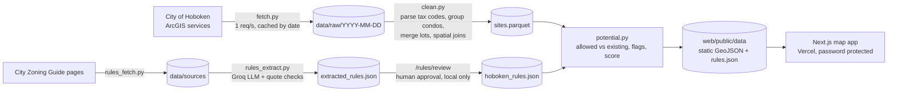

# Zoning Upside — Hoboken

Finds Hoboken, NJ properties where zoning appears to allow a bigger building, with more floors or
more units, than the one standing there today. Each property gets an upside score and a detail
view that shows the evidence: the exact rule text, its source link, and the formula used.

> **Estimate based on public zoning text; verify with the Hoboken Zoning Office.**
> These are estimates, not legal answers.

## Architecture



The website is static. It reads precomputed files and never calls City servers or the LLM. Data
changes only when you rerun the pipeline and redeploy.

## Repository layout

```
pipeline/            Python 3.11 data pipeline (fetch, clean, rules, potential) + tests
data/raw/            cached downloads by date (gitignored)
data/processed/      sites.parquet, potential.parquet, data_quality.md, potential_report.md
data/rules/          extracted_rules.json, hoboken_rules.json (approved), llm_cache/
notebooks/           01_data_walkthrough.ipynb: every cleaning step with outputs
web/                 Next.js App Router + TypeScript + Tailwind + shadcn/ui + MapLibre + TanStack Table
```

## Run the pipeline

```bash
uv venv --python 3.11 .venv && uv pip install --python .venv/bin/python -r pipeline/requirements.txt
.venv/bin/python -m pipeline              # fetch (uses cache) → clean → potential → web/public/data
.venv/bin/python -m pytest pipeline/tests # 115 tests: parsers, quote checks, potential, score, footprints
```

Zone rules (only needed when rules change):

```bash
cp .env.example .env                         # add GROQ_API_KEY (free tier)
.venv/bin/python -m pipeline.rules_fetch     # list sources, fetch Zoning Guide pages
.venv/bin/python -m pipeline.rules_extract   # LLM extraction with evidence checks
cd web && npm install && npm run dev         # approve zones at http://localhost:3000/rules/review
.venv/bin/python -m pipeline.potential       # recompute with the newly approved rules
```

## Refresh the data

```bash
.venv/bin/python -m pipeline --refresh   # re-download every layer into data/raw/<today>/
```

Without `--refresh`, nothing is downloaded again. Then redeploy (below). Tax records change
mostly once a year, so a monthly or quarterly refresh is enough.

## Run the web app locally

```bash
cd web && npm install && npm run dev     # http://localhost:3000 (no password in dev unless SITE_PASSWORD is set)
```

- **`/` Map:** properties coloured by score, filters, sortable table, CSV export, detail drawer
  with existing vs allowed, formulas, rule quotes, flags and score reasons.
- **`/zones`:** the approved rules, with each value's quote and source.
- **`/about`:** method, sources, limitations, roadmap.
- **`/rules/review`:** the rule approval page. It works only in local development.

## Deploy (Vercel)

1. Import the GitHub repo on vercel.com and set **Root Directory = `web`**. The framework is
   detected as Next.js.
2. Under **Settings → Environment Variables**, add `SITE_PASSWORD` (Production).
3. Deploy. Later pushes to `main` redeploy automatically.

From the CLI instead:

```bash
cd web
npx vercel login
npx vercel link                      # create or link the project
npx vercel env add SITE_PASSWORD production
npx vercel --prod
```

How the deployed site is protected (`web/src/middleware.ts`):
- **Password:** every page and every `/data/*` file requires a shared password. The visitor
  gets a cookie holding a SHA-256 of the password, valid for 30 days. Changing
  `SITE_PASSWORD` logs everyone out.
- **Fails closed:** if `SITE_PASSWORD` is missing in production, the site serves nothing (503).
- **Review page:** `/rules/review` and `/api/rules` return 404 in production. They are blocked
  in middleware, the page itself calls `notFound()`, and the API refuses requests outside
  development.

## How it works

**Sites from tax records.**
- The City's parcel layer has one record per lot or condo unit: 19,527 records in total.
- Condo units are grouped into condo buildings. These are not scored, because one unit owner
  cannot redevelop the building.
- A property listed on several lots, whether through `Additional Lots` or the same record
  repeated across lots, is merged into one site.
- The assessor's codes are parsed with tested regexes, e.g. `3F-2U` = 3 floors, frame, 2 units,
  and `25X100` = 2,500 sq ft. Codes that can't be read stay empty and are never guessed.
- Result: 4,001 sites (2,835 non-condo).

**Zone and constraints.**
- A site's zone is the zoning polygon covering most of it. Any disagreement with the tax
  record's zone is flagged.
- Constraint flags need a layer to cover at least 10% of the site: historic district, flood
  zone A/V, redevelopment area, redevelopment agreement, zoning in progress.

**Rules.**
- An LLM (Groq free tier) extracts each rule with a verbatim quote.
- Code checks that the quote exists in the source and that the number appears in the quote.
- A person approves each zone. Only approved values are used.
- Demo scope: 7 Zoning Guide zones (R-1, R-2, R-3, R-CP, C-1, C-2, C-3), covering 90% of
  non-condo sites.

**Potential.**
- **Which limits:**
  - Rules can state height and story limits per building type (`max_height_ft_residential`,
    `max_height_ft_commercial`, `max_stories_residential`, `max_stories_commercial`).
  - Calculations use residential/mixed-use limits first, then limits stated for all buildings,
    then commercial limits. A commercial fallback is noted in the formula.
- **Allowed floors:**
  - Zone states a story limit (R-1, R-CP, C-1, C-3): the lower of that limit and
    floor(height ÷ the zone's minimum floor-to-floor).
  - Zone states only a height (R-2, R-3, C-2):
    - Realistic = floor(height ÷ max(`TYPICAL_FLOOR_TO_FLOOR_FT`, zone minimum)). The default is
      11 ft, set in `pipeline/config.py`, so 40 ft → 3.
    - Theoretical maximum = floor(height ÷ zone minimum), so 40 ft → 4.
    - The score and table use the realistic number; the drawer shows both.
  - "Already over the limit" is checked against the theoretical maximum.
- **Footprint cross-check** (`pipeline/overture.py`):
  - Overture Maps building footprints for the Hoboken bounding box are downloaded once per
    release (`data/raw/overture/<release>/`, with fields id, geometry, height, num_floors, sources)
    and overlaid on each lot in EPSG:3424.
  - **Coverage** = area of the footprint union inside the lot ÷ lot area.
  - **Height and floors** come from buildings mostly inside the lot. Height is converted from
    metres to feet; floors are the stated count, or height ÷ 11 ft.
  - **Building detected — tax record may be outdated** (−40): the tax record says vacant, 0 floors
    or parking lot, but coverage is at least 30%.
  - **Floors disagree** (no penalty): tax floors and footprint floors differ by 2 or more.
  - The cross-check also exposed two parser bugs, now fixed: `21/2CB` (2½ floors) was read as 21,
    and `15U-1C` was read as 15 floors.
- **Already being built:** a tax description containing WIP, GUTTED, NEW CONST, UNDER CONST, U/C
  or DEMO is flagged "possibly under construction" (−40) and hidden by default. Similar-looking
  tags that are *not* flagged are listed for review in `data/processed/construction_tags.md`.
- **Condo master lots:**
  - Land-only master records on a condo lot are grouped into the condo building and never ranked
    (72 buildings).
  - Land-only lots that share block + base lot number with condo units (3) are flagged and hidden
    by default.
- **Allowed units:** lot area ÷ the zone's sq ft per unit, rounded as the rule says, or rounded
  down when it doesn't say.
- **Unused:** allowed − existing.
- **Nonconforming:** a building already over a limit is flagged, not counted as upside.

**Score (0–100).** The weights are in `SCORE_WEIGHTS` in `pipeline/potential.py`.
- Points for:

  | Factor | Points |
  |---|---|
  | Unused units | +35 |
  | Unused floors | +20 |
  | Land-driven value (building worth little compared with the land) | +15 |
  | Lot size | +10 |
  | Vacant land | +10 |
  | Older building | +5 |

- Points off for:

  | Factor | Points |
  |---|---|
  | Redevelopment agreement | −25 |
  | Historic district | −10 |
  | Nonconforming | −10 |
  | Possibly under construction (also hidden by default) | −40 |
  | Building detected on a lot the tax record calls empty | −40 |
  | Tax-exempt, class 15A–15F (also hidden by default) | −30 |
  | Irregular lot | −5 |

- Each site lists its reasons, e.g. "Zone allows 20 units; currently 0".
- Warnings shown as table badges: under construction, building detected, tax-exempt,
  redevelopment agreement, historic, nonconforming, large site (20,000 sq ft or more, where density
  alone overstates potential), disputed or pending rule.
- Grey table badges (they change the calculation but apply widely):
  - flood, only where height is measured from the design flood elevation
  - floors disagree
- Small lot and flood zones elsewhere appear only in the detail panel.
- Data dates (tax data, zoning layers, Overture release) are shown on the About page and at the
  bottom of every detail panel.
- Disputed rules: where the ordinance text quoted in the brief disagrees with an approved
  Guide value, both are shown. The only case is C-1 height, 60 ft vs 52 ft; allowed floors are
  5 either way.
- A high score means upside, not a low price. The data holds assessed values only, not asking
  prices.

## Data sources and terms of use

| Source | Used for |
|---|---|
| City of Hoboken ArcGIS services: zoning, redevelopment/rehabilitation areas, zoning in progress, redevelopment agreements, historic districts, advisory flood zones | zone and constraint layers |
| Hoboken parcel layer (ArcGIS, hosted by Civil Solutions) with NJ MOD-IV tax fields | lots, buildings, values |
| City of Hoboken Zoning Guide (ArcGIS Hub pages) | zone rules with quotes |
| Overture Maps buildings (CDLA Permissive 2.0 / ODbL), release recorded in `rules.json` | footprint cross-check |
| OpenFreeMap / OpenStreetMap contributors (ODbL) | basemap |

These are public services. Requests are rate-limited to 1 per second and cached, robots.txt is
respected, and sites with bot challenges are never bypassed. Check each publisher's terms
before any commercial use.

## Privacy

The parcel service also contains owner names and mailing addresses. They are never requested,
stored, displayed or exported:
- `pipeline/config.py` allow-lists the 18 property fields, and an assert keeps owner fields off
  that list.
- `fetch.py` rejects any response that contains them before anything is written to disk.

## Limitations

- These are estimates from public zoning text. Variances, site plan review, parking, setbacks,
  flood-elevation rules and historic review can all change the outcome.
- Tax building descriptions can be outdated, and year built is often a default (1901). The
  footprint cross-check catches some outdated records. Footprint data has its own gaps, though: a
  few lots have no height, and new buildings may be missing.
- Floor counts where a zone has no story limit are estimates at 11 ft per floor. The theoretical
  maximum at the zone's minimum floor height is also shown.
- Only 7 zones are loaded. Industrial, university and waterfront districts and redevelopment
  plan areas are shown but not scored.
- Sub-districts (C-2 Court Street) can't be located on the map, so affected sites are flagged.
- C-1 has no numeric density rule in the Guide, so its allowed units stay empty.
- C-1 height: the Guide's 60 ft / 5 stories is stated for **commercial** buildings and has no
  residential/mixed-use limit. The ordinance text quoted in the brief says 52 ft / 5 stories.
  - C-1 is marked *needs re-approval* until the residential limit is confirmed on the review page.
  - The ordinance (ecode360) blocks automated access.
  - Allowed floors are 5 either way.
- Existing lot coverage is not in the data.

## Roadmap

- Load the remaining zones from ordinance sections and redevelopment plan PDFs.
- Nearby Planning and Zoning Board approvals that exceeded zoning (Phase 5).
- Cross-check floors with open building-height data (Overture Maps).
- Land cost per allowed unit, and asking prices from listings.
- Scheduled monthly refresh, with rule changes queued for human review.
- Jersey City, which relies heavily on redevelopment plans, and more towns.
